# **🚀 Python Application CI/CD Automation using Jenkins, GitHub Webhook & AWS EC2**

## **📌 Project Overview**

This project demonstrates the automated deployment of a Python Flask application using **Jenkins CI/CD Pipeline, GitHub Webhooks, and AWS EC2**.

Whenever new code is pushed to the GitHub repository, a webhook triggers Jenkins automatically. Jenkins checks out the latest source code, installs Python dependencies, creates a virtual environment, validates the application, and deploys it to a target EC2 instance through SSH. The pipeline then starts the application and performs a health check to verify that the deployment is working.

The project also includes a responsive web dashboard built using HTML and CSS to demonstrate the GitHub-to-Jenkins automation workflow.

## **🎯 Project Objectives**

- Automate application deployment using Jenkins.
- Trigger builds automatically through GitHub Webhooks.
- Configure a Jenkins pipeline using a `Jenkinsfile`.
- Install Python dependencies in an isolated virtual environment.
- Validate Python application code before deployment.
- Deploy the application to an AWS EC2 target server using SSH.
- Verify application availability after deployment.

## **🏗️ Architecture Flow & Diagram**


```text
       Developer
           |
           | Git Push
           v
      GitHub Repository
           |
           | Webhook (HTTP POST)
           v
       Jenkins Server
           |
           v
     Checkout Source Code
           |
           v
      Install Python
           |
           v
   Create Virtual Environment
           |
           v
    Install Dependencies
           |
           v
     Build / Validate
           |
           v
   SSH to Target EC2 Server
           |
           v
     Deploy Flask Application
           |
           v
      Start Application
           |
           v
      Verify Application
           |
           v
     Application Dashboard
```

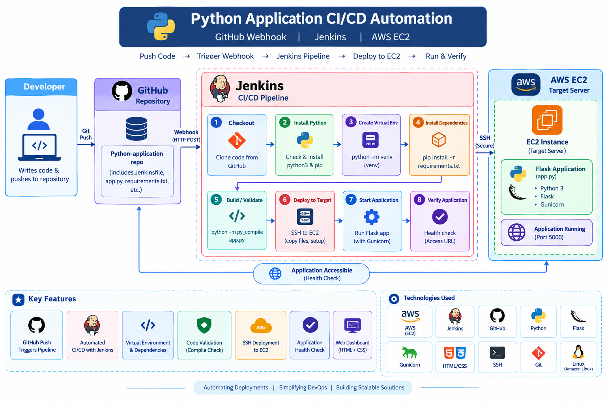

## **🛠️ Technologies Used**

| Category | Technologies |
|---|---|
| Cloud Platform | AWS |
| Compute | Amazon EC2 |
| CI/CD | Jenkins |
| Version Control | Git, GitHub |
| Automation | GitHub Webhooks |
| Programming Language | Python |
| Web Framework | Flask |
| Web Technologies | HTML, CSS |
| Python Environment | venv, pip |
| Application Server | Gunicorn |
| Remote Deployment | SSH |
| Operating System | Amazon Linux |
| Pipeline Configuration | Jenkinsfile |


## **☁️ AWS Infrastructure**

The project uses two EC2 instances:

- **Jenkins Master:** Runs Jenkins and executes the CI/CD pipeline.
- **Target Server:** Receives the application deployment and runs the Python application.

SSH is used for communication between the Jenkins server and the target server.

The target server's security group must allow SSH access from the Jenkins server, and the application port must be accessible for testing the deployed application.

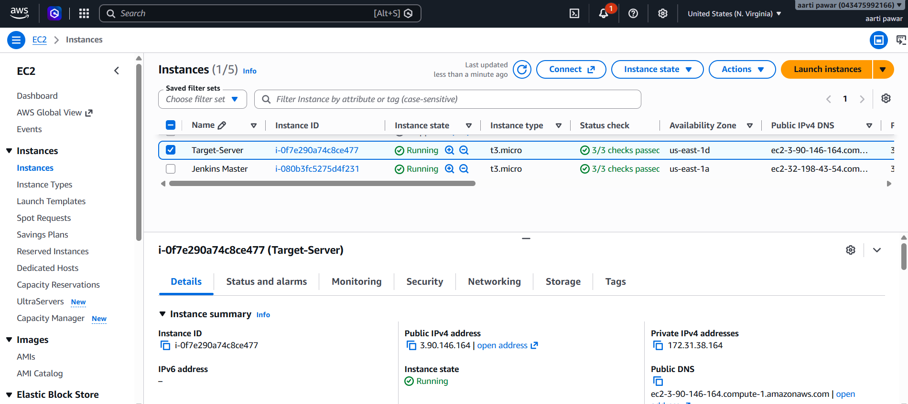


## **📂 Repository Structure**

```text
Python-application/
│
├── static/
│   └── CSS, JavaScript and static assets
│
├── templates/
│   └── index.html
│
├── tests/
│   └── Application tests
│
├── app.py
├── Jenkinsfile
├── requirements.txt
└── README.md
```

## **Configure GitHub Webhook**

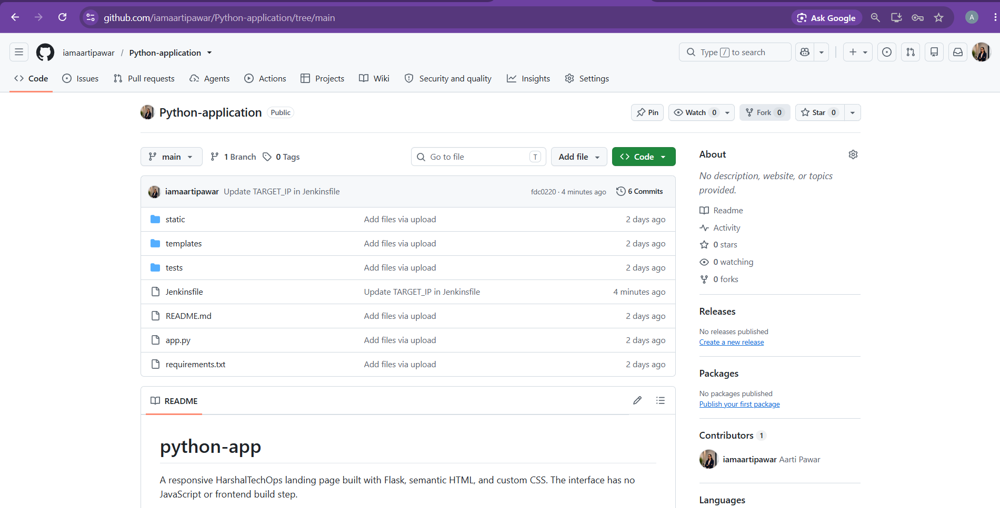

In the GitHub repository, open **Settings → Webhooks → Add webhook**.

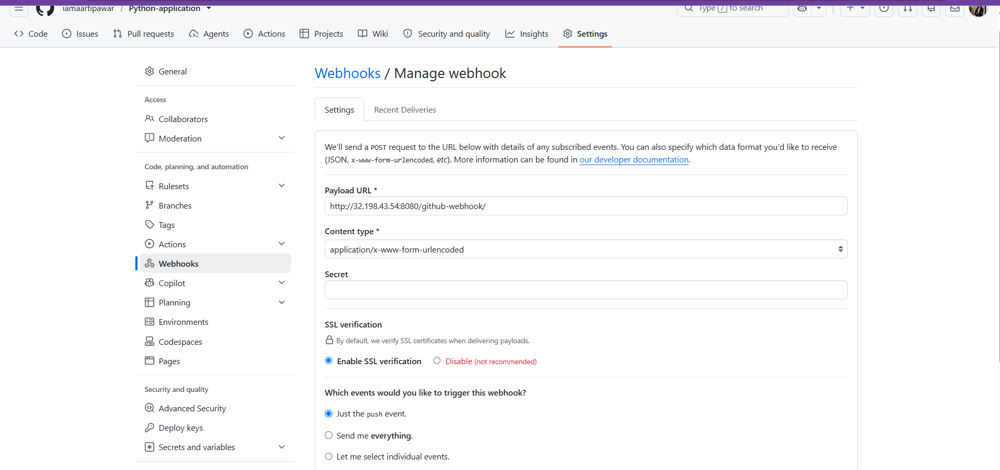

Configure the webhook payload URL to point to your Jenkins webhook endpoint, select the appropriate content type, and enable push events.

Ensure Jenkins is reachable from GitHub through a properly configured and secured endpoint.

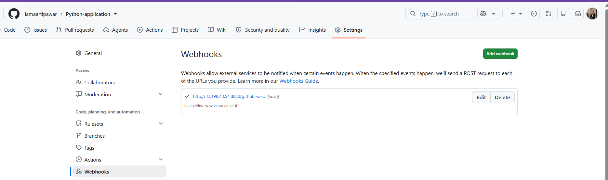

## **🚀 How to Run the Project**

### **Prerequisites**

- AWS account with EC2 instances.
- Jenkins installed and configured.
- GitHub repository with webhook access to Jenkins.
- Python 3 and pip.
- SSH connectivity between the Jenkins server and target server.
- Required SSH credentials configured securely in Jenkins.

### **Step 1: Configure Jenkins**

1. Create a Jenkins Pipeline job.
2. Select **Pipeline script from SCM**.
3. Choose Git as the source control system.
4. Enter the repository URL:

   `https://github.com/iamaartipawar/Python-application.git`

5. Select the `main` branch.
6. Set the script path to `Jenkinsfile`.
7. Configure the required SSH credentials in Jenkins.

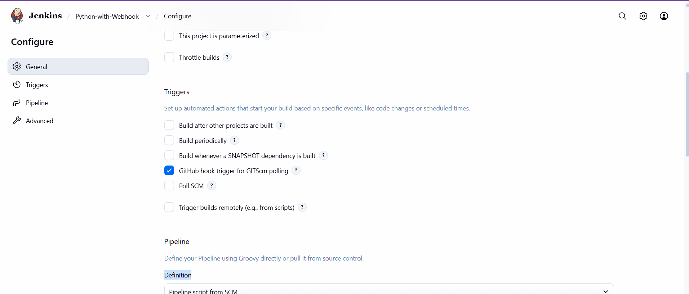
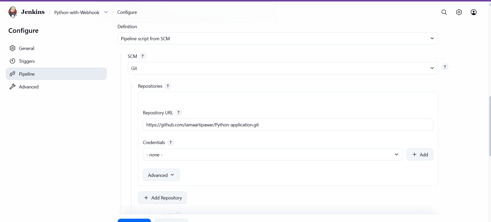
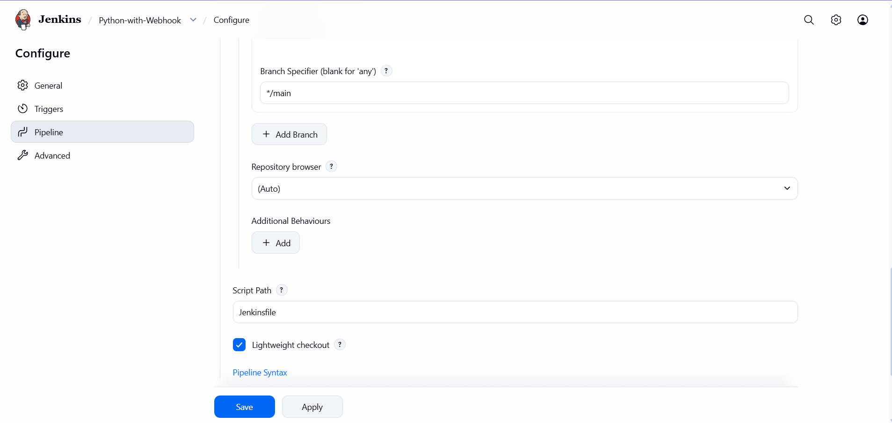
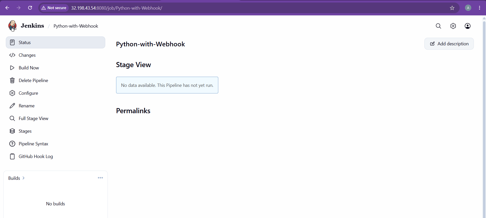


### **Step 2: Clone the Repository**

```bash
git clone https://github.com/iamaartipawar/Python-application.git
cd Python-application
```

### **Step 3: Trigger Deployment**


```bash
git add .
git commit -m "Update application"
git push origin main
```

Make simple change first then push:
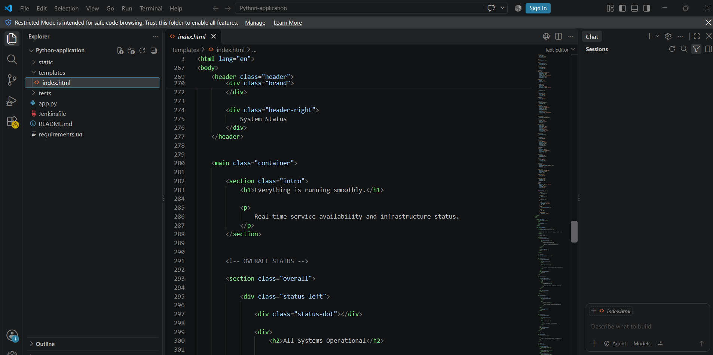
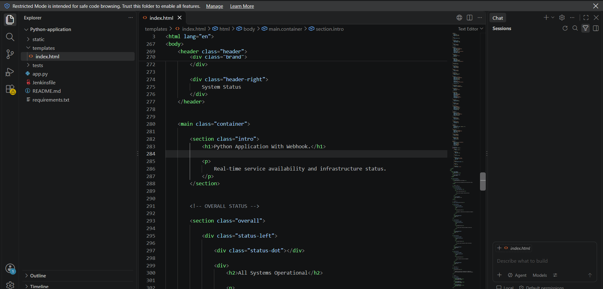
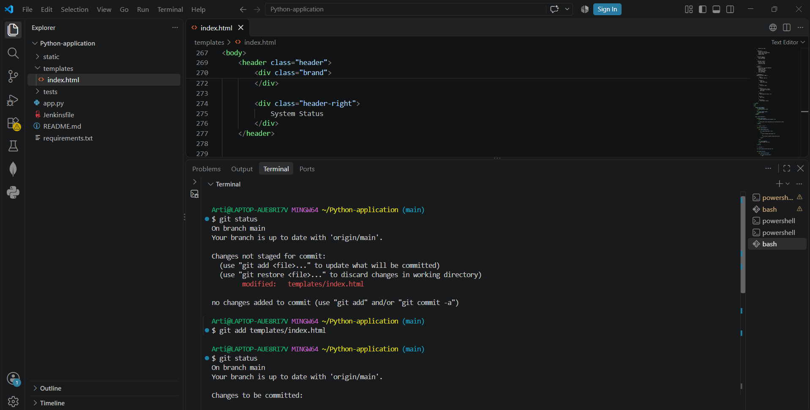
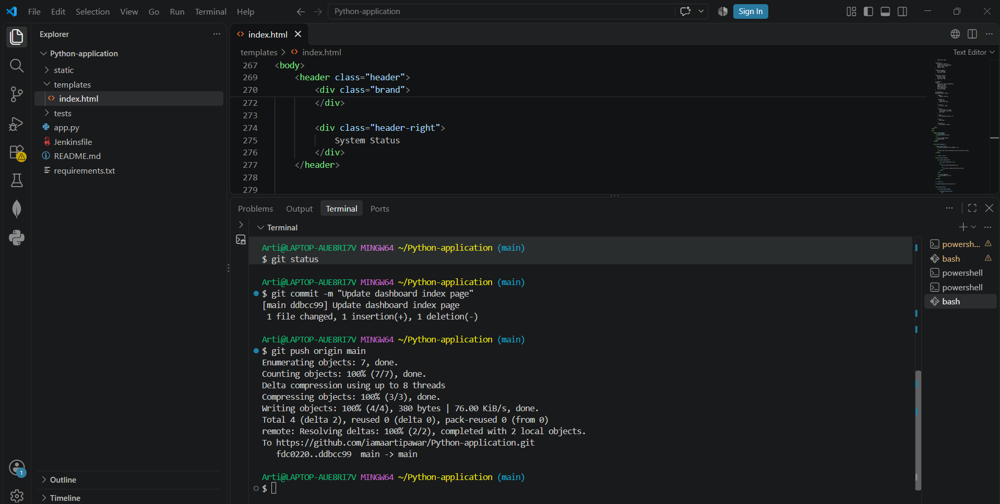

Then check your pipeline automatically run

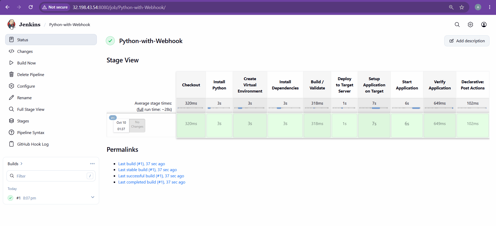

Push a new commit to the repository:
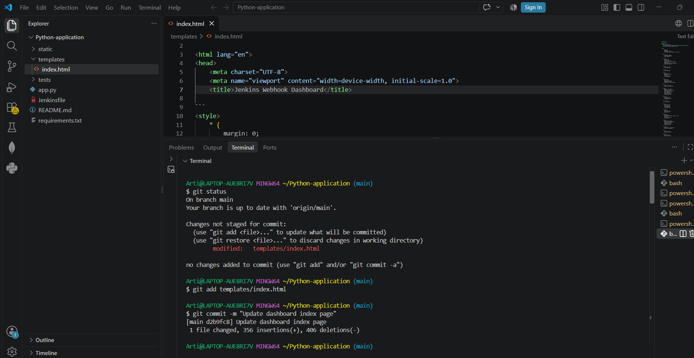
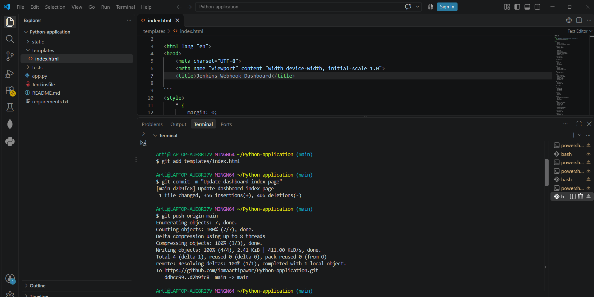

Again check your second change is run automatically

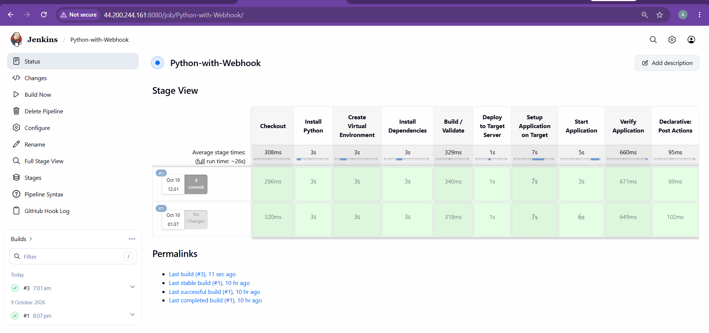

GitHub sends the push event to Jenkins, which starts the configured pipeline automatically.

### **Step 4: Run your target server IP:5000**
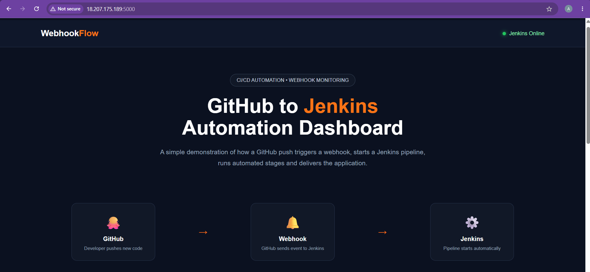

## **⚙️ Jenkins Pipeline Stages**

The pipeline is divided into the following stages:

### **1. Checkout**
Retrieves the latest application source code from the GitHub repository.

### **2. Install Python**
Checks and installs Python 3 and pip on the Jenkins environment when required.

### **3. Create Virtual Environment**
Creates an isolated Python virtual environment to manage application dependencies.

### **4. Install Dependencies**
Upgrades pip and installs the packages listed in `requirements.txt`, including Flask and Gunicorn.

### **5. Build / Validate**
Validates the Python application using Python's compilation check before deployment.

```bash
./venv/bin/python -m py_compile app.py
```

### **6. Deploy to Target Server**
Connects to the target EC2 instance using SSH and prepares the application directory for deployment.

### **7. Setup Application on Target**
Transfers the application files and prepares the Python environment on the target server.

### **8. Start Application**
Starts the deployed Flask application using the configured application startup process.

### **9. Verify Application**
Performs a health check to confirm that the deployed application is responding as expected.

### **10. Post Actions**
Displays the pipeline completion or failure status in the Jenkins console output.

## **🔔 GitHub Webhook Integration**

GitHub Webhooks connect the repository with Jenkins and automate pipeline execution.

**Workflow:**
1. A developer updates the application code.
2. The changes are committed and pushed to GitHub.
3. GitHub sends a webhook event to Jenkins.
4. Jenkins detects the event and starts the pipeline.
5. The pipeline executes the configured deployment stages.

This reduces the need to start every deployment manually.


## **✅ Results**

The project demonstrates:

- GitHub push-based pipeline triggering.
- Automated source code checkout.
- Python environment creation and dependency installation.
- Application syntax validation.
- SSH-based deployment to an EC2 target server.
- Application startup and health-check stages.
- Jenkins Stage View for monitoring pipeline execution.
- A responsive dashboard demonstrating the automation workflow.

## **📚 Key Learnings**

Through this project, I gained practical experience with:

- CI/CD pipeline implementation using Jenkins.
- GitHub webhook integration.
- Jenkins Pipeline as Code using a `Jenkinsfile`.
- Python application dependency management.
- AWS EC2 infrastructure and remote server access.
- SSH-based application deployment.
- Pipeline stage monitoring and troubleshooting.
- Automating repetitive deployment tasks.

## **🔮 Future Improvements**

- Add automated unit tests before deployment.
- Integrate Docker for containerized application deployment.
- Add notifications for pipeline success and failure.
- Improve application monitoring and centralized logging.
- Configure HTTPS and secure the webhook endpoint.
- Add automated rollback for failed deployments.

## **👩‍💻 Author**

**Aarti Pawar**

Aspiring DevOps Engineer | Learning AWS, Jenkins, Docker & CI/CD Automation


